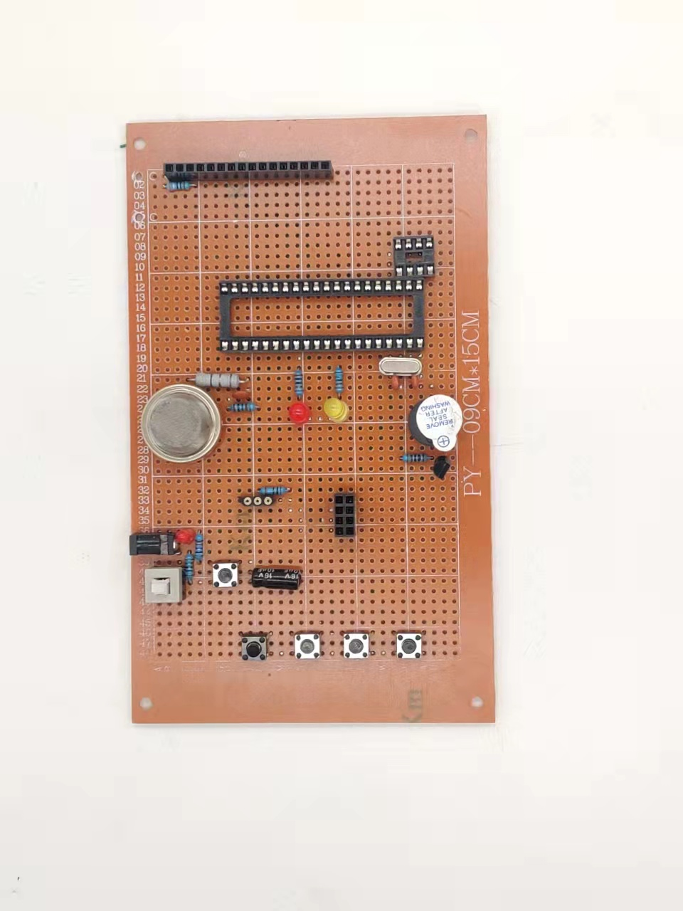
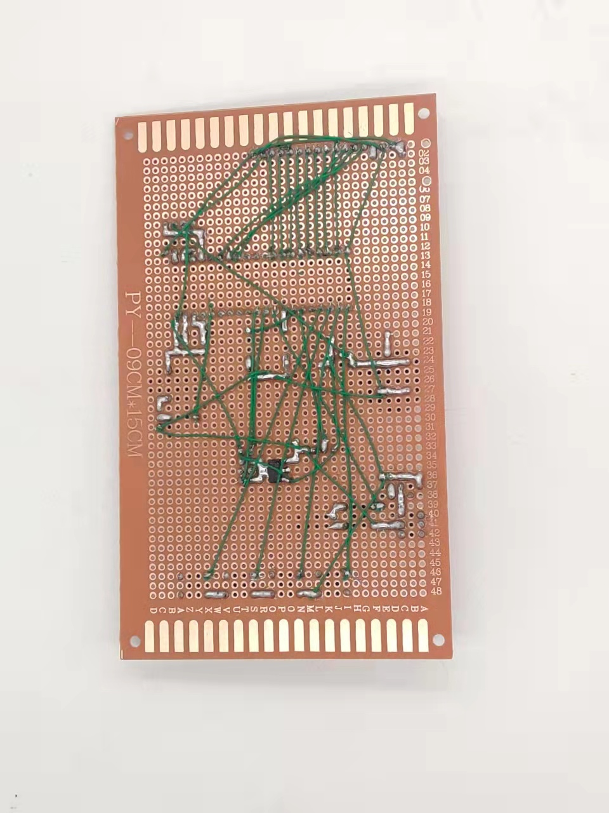
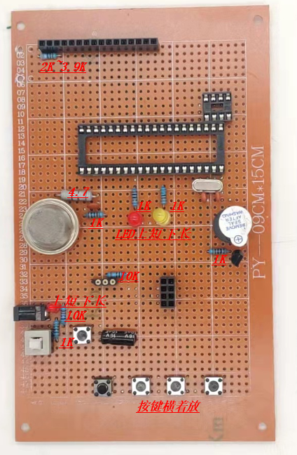

# 基于 STC89C52 + ESP8266 的 WiFi 智能火灾报警系统

51 单片机 + MQ-2 烟雾 + DS18B20 温度，本地 LCD1602 显示与声光报警，同时通过 ESP8266 把状态上报到服务器，手机端可远程查看与下发控制指令。



正面：LCD1602、MQ-2、DS18B20、4 个按键、双色指示灯



背面：焊接面与模块插座



## 功能

| 功能 | 说明 |
|---|---|
| 温度采集 | DS18B20 单总线，0.0625℃ 分辨率 |
| 烟雾采集 | MQ-2 + ADC0832，0~250 映射为 0~99 的「报警值」 |
| 本地显示 | LCD1602 两行：温度值 / 烟雾报警值 |
| 本地报警 | 超阈值蜂鸣器 + 红黄双色指示；支持手动紧急报警 |
| 阈值设置 | 4 按键：设置 / 加 / 减 / 手动报警，写 EEPROM 掉电保存 |
| 联网上报 | ESP8266（AT 指令）连 WiFi，TCP 定长帧上报温度、烟雾、三路报警状态 |
| 远程控制 | 手机端/服务器下发 `B1~B5` 指令，远程调温度阈值、烟雾阈值、切换手动报警 |

## 硬件

| 器件 | 型号 | 数量 | 作用 |
|---|---|---|---|
| 主控 | STC89C52RC | 1 | 11.0592MHz（串口波特率需要） |
| WiFi 模块 | ESP8266-01S / ESP-12 | 1 | AT 固件，串口透传 |
| 温度 | DS18B20 | 1 | 单总线 |
| 烟雾 | MQ-2 + ADC0832 | 1+1 | 模拟量转 8 位数字 |
| 显示 | LCD1602 | 1 | 并行 8 位 |
| 报警 | 有源蜂鸣器 + LED×2 | 1+2 | — |
| 交互 | 独立按键 | 4 | — |
| 电源 | 5V / 3.3V | — | ESP8266 必须 3.3V，且要能供 300mA 峰值 |

## 引脚分配

| 功能 | 引脚 | 备注 |
|---|---|---|
| LCD1602 D0~D7 | P0 | 需 10kΩ 排阻上拉 |
| LCD1602 RS / RW / E | P2.5 / P2.6 / P2.7 | — |
| DS18B20 DQ | P1.5 | 4.7kΩ 上拉 |
| ADC0832 CS / SCL / DO | P2.3 / P2.0 / P2.1 | 软件模拟时序 |
| 蜂鸣器 | P3.6 | NPN 驱动 |
| 温度报警灯（黄） | P1.6 | — |
| 烟雾报警灯（红） | P1.7 | — |
| ESP8266 TXD / RXD | P3.0 / P3.1 | 交叉连接，模块 TX→单片机 RX |
| ESP8266 CH_PD / VCC | 3.3V | CH_PD 必须拉高才工作 |

接线细节见 [docs/接线表.md](docs/接线表.md)，通信帧格式见 [docs/通信协议.md](docs/通信协议.md)。

## 软件结构

```
main()
 ├─ 初始化：IO → EEPROM 读阈值 → 读温度 → 串口(9600) → 定时器 → LCD1602 → ESP8266 联网
 └─ while(1)
     ├─ key()            按键扫描
     ├─ send_set()       解析服务器下发的 B1~B5 指令
     ├─ key_with()       按键动作
     ├─ 每 300ms：
     │   ├─ clock_h_l()  阈值比较、声光报警、更新上报帧状态位
     │   ├─ read_temp()  读温度
     │   └─ ad0832read() 读烟雾 → 换算
     └─ 定时上报 / 报警时立即上报
```

## 通信协议

上报帧为 14 字节定长 ASCII：`1234` + 4 位设备号 + 6 位状态，第 11~13 位分别表示烟雾 / 温度 / 手动报警（`0`=报警中，`1`=正常）。下行指令 `B1`~`B5` 分别对应温度阈值 +10、温度阈值 −10、烟雾阈值 +1、烟雾阈值 −1、切换手动报警。

详见 [docs/通信协议.md](docs/通信协议.md)。

## 编译与烧录

1. Keil uVision5 新建 C51 工程，芯片选 `STC89C52`，晶振 `11.0592MHz`
2. 加入 `src/main.c` 与 `src/` 下 4 个头文件
3. **先把 `src/esp8266.h` 里的账号、设备 ID、服务器地址换成你自己的**（仓库里是占位符）
4. Build 生成 hex → STC-ISP 下载 → 断电重上电
5. 串口助手波特率 9600，可看到 ESP8266 的 AT 交互日志

## 遇到的问题

见 [docs/排错记录.md](docs/排错记录.md)：ESP8266 连不上热点、上报数据偶尔乱码、LCD1602 只显示方块、阈值重启丢失、传感器预热误报等。

## 已知不足

1. ESP8266 用 AT 指令 + 固定服务器 IP，换网络要重新烧录
2. 上报是明文 TCP，没有加密与重连退避
3. 未做断网缓存，断网期间的数据会丢
4. 服务器端是课程提供的简易 TCP 服务，非生产可用

## 声明

本工程由学习套件例程整理而来，用于个人学习记录。原例程中的第三方账号、服务器地址与设备 ID 已全部替换为占位符，请勿直接使用他人服务。硬件方案参考公开资料，未用于商业用途。